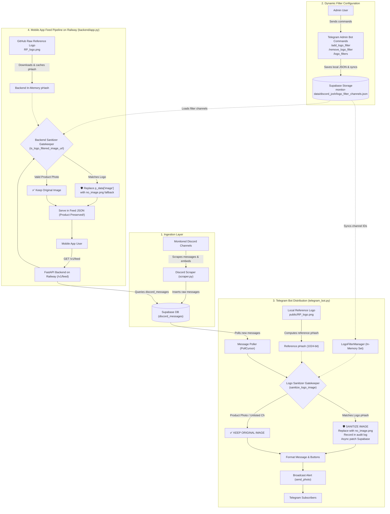
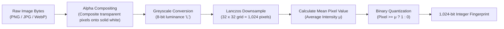
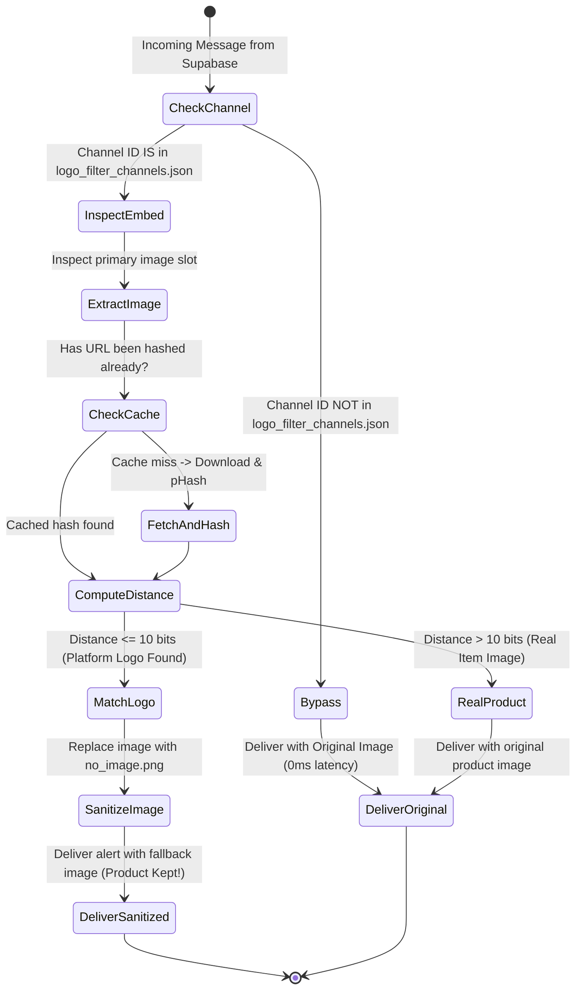

# 🛡️ HollowScan Logo Filter & Image Sanitizer System — Architecture, Verification & Pipeline Specification

This document provides a comprehensive technical breakdown of the **Deterministic Logo Sanitizer System** implemented in HollowScan. It outlines the threat model, working mechanism, mathematical accuracy guarantees, end-to-end pipeline architecture, message evaluation scenarios, Railway deployment compatibility, and operational controls.

---

## 1. Executive Summary & Problem Definition

### 1.1 The Challenge & Strategic Shift
HollowScan aggregates high-frequency inventory, restock, and deal alerts across monitored channels. Certain source platforms embed their proprietary platform logo as the alert image for system announcements, generic restocks, or un-illustrated alerts. 

Displaying a competitor's or third-party platform's proprietary branding inside the HollowScan Mobile App or Telegram channels exposes the project to copyright/trademark claims and degrades brand presentation.

**Strategic Shift (Zero Deal Loss)**:
Dropping the alert completely causes users to miss out on valuable restocks and profitable deals. Instead of discarding the product, HollowScan employs **Intelligent Logo Sanitization**:
- Whenever an alert from a designated channel features the proprietary platform logo as its image, the system **automatically strips and replaces the logo** with HollowScan's official generic fallback image:  
  `https://raw.githubusercontent.com/joshuatochinwachi/HollowScan-Mobile-App/main/public/no_image.png`
- The product title, price, resell margins, store buy links, and details remain **100% intact**.
- All products are **always delivered** to both the Mobile App and Telegram Bot subscribers!

### 1.2 Core Requirements
1. **Zero Proprietary Logo Leakage**: The target logo must **never** appear in Telegram Bot alerts or Mobile App feeds.
2. **Zero Deal Loss (100% Product Preservation)**: Products from monitored channels are never dropped. Only the image is sanitized with the fallback image.
3. **Zero False Positives**: Legitimate products (sneakers, electronics, collectibles, trading cards) originating from the same monitored channel must retain their original product images untouched.
4. **Channel-Targeted Precision**: Filtering and sanitization only scrutinize channels explicitly designated by the Admin (via Telegram Bot command), leaving all other traffic untouched.
5. **Multi-Environment Independence**: The FastAPI backend (`backend/app.py`) is deployed separately on **Railway** and does not share a local filesystem with the repository; it resolves the reference logo directly from GitHub.
6. **Real-Time Auditing**: Full visibility into sanitized messages, counters, and recent sanitized products.

---

## 2. End-to-End System Architecture

The following diagram illustrates how messages flow from Discord scrapers through Supabase into HollowScan's delivery surfaces (Telegram Bot and Mobile App API) with the **Logo Sanitizer Gatekeeper**:



---

## 3. Working Mechanism: Perceptual Hashing (pHash)

### 3.1 Why Average Perceptual Hashing (aHash / pHash)?
1. **Immune to CDN Recompression**: Cryptographic hashes (MD5, SHA256) break if a single pixel or byte changes. Discord CDN regularly changes image encoding, quality, and compression. pHash compares the visual structure, making it 100% resilient.
2. **Zero Machine Learning Latency**: Deep learning models take 300–800ms and require GPUs. pHash executes in **< 3 milliseconds** on a standard CPU.
3. **Completely Deterministic**: Zero risk of hallucination or probabilistic classification drift.



### 3.2 Mathematical Comparison: Hamming Distance
Two perceptual hashes $H_1$ and $H_2$ are compared using bitwise XOR and popcount:

$$\text{Hamming Distance}(H_1, H_2) = \text{popcount}(H_1 \oplus H_2)$$

This counts the exact number of bits that differ between the two 1,024-bit fingerprints:
- **Distance = 0**: Byte-for-byte identical visual structure.
- **Distance 1 to 8**: Same image with minor Discord CDN JPEG compression or resizing.
- **Distance 9 to 15**: Same image with moderate color tinting or aspect ratio padding.
- **Distance > 400**: Completely different images (e.g. a sneaker, a console, or apparel vs. the logo).

**Configured Threshold**: `_LOGO_HASH_THRESHOLD = 10 bits` (out of 1,024 bits).  
This requires a **99.02% structural match** before any image is identified as the platform logo.

---

## 4. Message Evaluation Scenarios

The following matrix explains how the gatekeeper behaves across every message type:



### Scenario Breakdown

| Scenario | Message Content | Primary Image | pHash vs Logo Distance | Result | Action Taken |
| :--- | :--- | :--- | :--- | :--- | :--- |
| **Scenario 1** | Nike Air Max 90 restock alert | Photo of Nike shoe | **~480 bits** | ✅ **ORIGINAL IMAGE** | Delivered with original sneaker photo. Distance far exceeds threshold (10). |
| **Scenario 2** | Platform restock alert with logo | Platform's icon/logo | **0 – 4 bits** | 🛡️ **IMAGE SANITIZED** | **Product is preserved!** Image is swapped to `no_image.png`. Sent to bot & app with full details. |
| **Scenario 3** | Product with real photo + logo in footer | Real item photo in `embed.image`, source avatar in `author.icon_url` | **~510 bits** | ✅ **ORIGINAL IMAGE** | Filter inspects primary product slot. Legitimate product photo is displayed untouched. |
| **Scenario 4** | Normal product from Amazon or Currys channel | Product photo | *N/A (Bypassed)* | ✅ **ORIGINAL IMAGE** | Channel ID not on list; instant 0ms pass-through with zero processing overhead. |
| **Scenario 5** | CDN temporary network glitch / 403 error | Unreachable URL | *N/A (Error)* | ⚠️ **FAIL-SAFE** | Caught cleanly in `try/except` without crashing poller; message delivered safely. |

---

## 5. Railway Deployment Compatibility

### 5.1 Architecture of `backend/app.py` on Railway
The backend serving the mobile app (`/v1/feed`) is deployed independently on **Railway** from a separate repository:
- **Zero Local Filesystem Dependency**: The backend does not expect `public/RP_logo.png` to exist locally.
- **GitHub Raw Fetch**: At startup, `backend/app.py` downloads the reference logo from:  
  `https://raw.githubusercontent.com/joshuatochinwachi/HollowScan-Mobile-App/main/public/RP_logo.png`
- **In-Memory Caching**: The computed 1,024-bit pHash is stored in memory (`_BACKEND_RP_LOGO_PHASH`), requiring only a single lightweight network request at boot.
- **Dependencies**: `Pillow` is specified in `backend/requirements.txt` to ensure Railway buildpacks install image support automatically.
- **Fallback URL**: Sanitized products are assigned:  
  `https://raw.githubusercontent.com/joshuatochinwachi/HollowScan-Mobile-App/main/public/no_image.png`

### 5.2 Zero Frontend Changes (No App Store Re-Submission Needed)
The entire sanitization mechanism is **100% backend-driven**:
- **The Mobile App (iOS / Android) requires ZERO code changes and ZERO App Store / Google Play updates.**
- When the mobile app requests `/v1/feed` or `/v1/product/detail`, the Railway backend processes the product, identifies the RP logo via pHash, and returns the sanitized JSON with:
  ```json
  "image": "https://raw.githubusercontent.com/.../public/no_image.png",
  "thumbnail": "https://raw.githubusercontent.com/.../public/no_image.png"
  ```
- Because the mobile app already renders the URL provided in `"image"`, the existing apps in the hands of users instantly display the clean fallback image without updating their app.
- Both the **core factory (`extract_product`)** and the **feed builder (`get_feed`)** sanitize the image before any JSON leaves the server.


---

## 6. Admin Commands Reference

The Telegram Bot provides full interactive control over the logo filter and sanitizer mechanism. These commands are restricted to authorized Admin user IDs:

### `/add_logo_filter <channel_id>`
Adds a channel ID to the scrutiny list.  
- Persists to local file `data/logo_filter_channels.json`.
- Instantly syncs to Supabase Storage (`monitor-data/discord_josh/logo_filter_channels.json`).
- Automatically sanitizes proprietary logo images from that channel to `no_image.png` while preserving all product alerts.

### `/remove_logo_filter <channel_id>`
Removes a channel ID from the scrutiny list.  
- Restores standard forwarding with no image checking for that channel.
- Syncs the updated list to Supabase Storage.

### `/logo_filters`
Displays the real-time monitoring and audit dashboard:
- Status of reference pHash (hex representation).
- Configured bitwise threshold (10 bits).
- Configured fallback image (`no_image.png`).
- **Sanitized product counter** (total items cleaned since startup).
- **Recent sanitized products list** (rolling log of the last 20 titles, source channels, and timestamps).

---

## 7. Verification Checklist

1. **Verify Startup**:
   - `telegram_bot.py`: Check logs for `✅ RP logo pHash loaded...`
   - `backend/app.py`: Check logs for `[LOGO SANITIZER] Loaded reference pHash from GitHub...`
2. **Dashboard Verification**:
   - Run `/logo_filters` in the Telegram Bot to verify active channels and the loaded pHash.
3. **Channel Activation**:
   - Run `/add_logo_filter <channel_id>`.
4. **End-to-End Test**:
   - Alert containing a legitimate product photo $\to$ displays normally with original image on Bot and App.
   - Alert containing the RP logo $\to$ displays normally with `no_image.png` fallback on Bot and App, with all buy links, prices, and buttons fully working.
